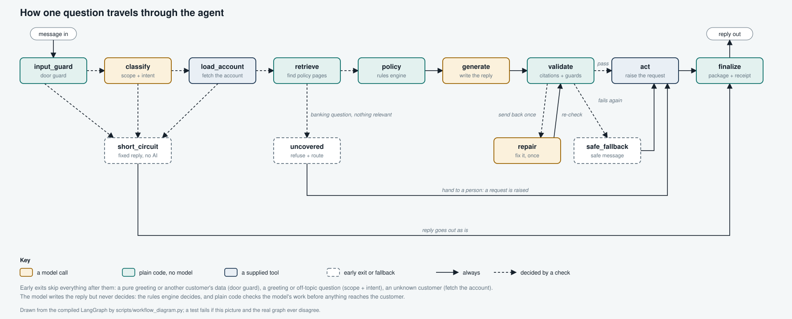

# Architecture and its trade-offs

Every decision below buys something and costs something. This page says which, with the evidence. The full design is in [`SPEC.md`](../SPEC.md); what is measured and what is not is in [`scaling.md`](scaling.md).

## The shape

*Drawn from the compiled LangGraph by `scripts/workflow_diagram.py` (`make workflow`); a test fails if the picture and the real graph disagree.*

Read it left to right along the top: that is the path of a normal question. Dashed arrows are decided by a check, and everything below the top row is an exit or a loop: a fixed reply that needs no model, a question the policies cannot answer, and the one repair attempt before a safe message. Safety-critical steps are fixed edges, so the model cannot skip the account lookup, the rules or the validation.

## Decisions, and what each one cost

| # | Decision | Why | What I gave up | Evidence |
|---|---|---|---|---|
| 1 | **Deterministic rules decide every credit outcome; the model only explains it** | Auditable and repeatable; the model cannot approve a limit even if it tries | Every rule is hand-written from the corpus, so a new policy means code and tests, and it does not scale to a 100x corpus without ingestion-time tooling | `policy/rules.py`; Safety passed on 31 of 31 eval replies |
| 2 | **Nothing reaches the customer until the whole draft is validated, so no raw token streaming** | Citations and numbers are checked on the complete draft, and a repair pass may rewrite it | Time to first text: p50 18.5 s. The UI hides the wait with live step labels and a progressive reveal of the *validated* reply. The real fix, an incremental validator, is not built | `agent/graph.py`; `docs/sample_traces.md` |
| 3 | **A strict citation contract** (every claim cited, every number found in its source; one repair, then a safe fallback) | Grounding is enforced by code, not requested in a prompt | Occasional wasted work: 1 of 31 eval replies needed a repair. The model's wording is constrained | `guardrails/citation_validator.py` |
| 4 | **A fixed graph, not a free tool-calling agent** | Predictable, testable, and the order of the safety steps cannot be changed by the model | One intent per message by design, plus an extra classifier call. Multi-intent questions are a structural weak spot (my predicted failure AP-012 happened to pass, so this is untested ground, not proof it is fine) | `agent/graph.py` |
| 5 | **A scope gate before the account lookup** | An off-topic question costs about $0.001 and 2 to 4 s, with no tool call and no ticket | An unknown customer now costs one classifier call before being refused. A wrong "off-topic" label would silently block a real question; the classifier leans towards in-scope, but only four goldens test that boundary | `guardrails/scope.py`; goldens AP-016 to AP-019 |
| 6 | **Retrieval runs in-process** (BM25 plus exact cosine over a small matrix, persisted by corpus fingerprint; no vector database) | Right for 12 documents: no infrastructure, deterministic, easy to audit | It will not scale to 100x or to many tenants (design in `scaling.md`). Chunks are coarse, so the fee table is one chunk: contextual relevancy is 0.35. The `Retriever` and `VectorStore` protocols are where a real store would plug in | `retrieval/hybrid.py`; pipeline report |
| 7 | **A reasoning model for generation** (`gpt-5`, low effort) | It is the model my key provides, and it followed the refusal and citation rules well in the evals. I did not compare other models | About $0.017 and 18 s per turn. The default `gpt-4o-mini` is faster and cheaper, but I have not evaluated it | `evals/reports/application/report.md` |
| 8 | **In-memory conversation state** | Simple, and enough for a demo | A thread dies with the process, so it cannot scale out, and edit or replay of an old thread loses its context after a restart | `agent/service.py` |
| 9 | **Deterministic eval gates; LLM-judged scores are reported, not gating** | Judges are noisy and would make CI flaky | Judged metrics can drift unnoticed, and the judge is the same model family as the agent | `evals/README.md` |

## Where the trade-offs show up in practice

- **Decision 1 and 3** are why the open-dispute case in `sample_traces.md` is declined by rule `DECLINE_OPEN_DISPUTE` before the model writes a word.
- **Decision 2** is the 18-second wait you see in every live capture in `sample_traces.md`: the generator takes 6 to 16 s of it.
- **Decision 6** is why contextual relevancy is low even though retrieval recall is 1.00: it is a chunking problem, not a ranking problem.
- **Decision 5** is why "Who is the Prime Minister of India?" returns in about 4 s at $0.0013, while a real question costs about $0.017.
